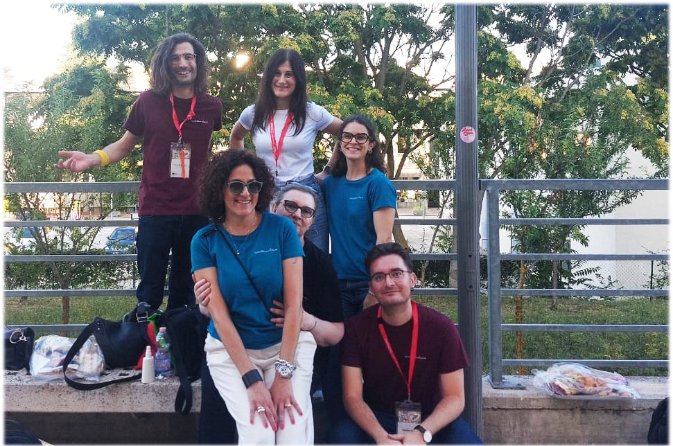
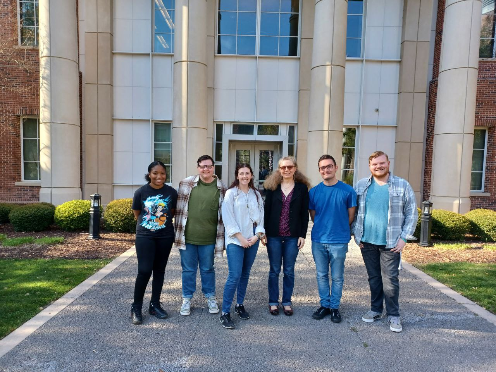

Hello, I am Massimo Aloisi, a Postdoc Fellow at the University of L'Aquila in the CanceREvolution lab. My main scientific interests focus on <strong>disease modelling</strong> and <strong>environmental mutagenesis</strong>.  

Previously, I  have achieved my PhD in Cellular and Molecular Biotechnologies at the University of Teramo in the Genetics and Mutagenesis lab. The rationale of my thesis was to investigate the role of the <strong>genetic background in responding to environmental stressors</strong>. In particular, I employed <em>in vitro</em> cell cultures and <em>Drosophila melanogaster</em> to untangle micro-and nanoplastics (MPs and NPs) biological and mutagenic effects. In addition, I studied the contribution of NPs in cancer progression and in worsening phenotype severity of Polycystic Kidney Disease and TANGO2 Deficiency Disorder, using <em>Drosophila</em> genetic models.     

Currently, I am focusing on <em>Phoenix rising</em> in prostate cancer. I am employing several cell lines and the fruitfly to deconvolute molecular mechanisms underlying <strong>resistance induced by anti-cancer therapy</strong>. In particular, I am interested in the role of prostaglandin E2 in inducing epithelial-mesenchymal transition.     

As well as my academic interests, I am committed to <strong>science communication</strong>. Our era is characterised by rapid technological progress; we are immersed in a vast amount of information. I firmly believe that all of this can be misleading and make it difficult to find answers and insights, even for experts. Therefore, science communication is essential to help bringing clarity to this chaotic, information-overloaded system. Reaching a diverse audience will help both the general public and scientists themselves to understand the world around us and to gather ideas for shaping future research directions.   

