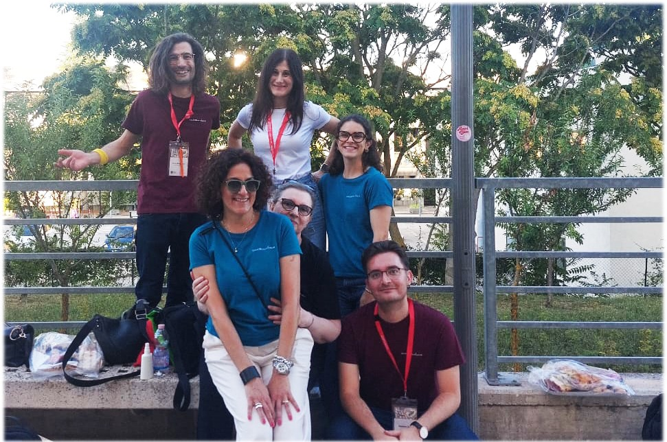
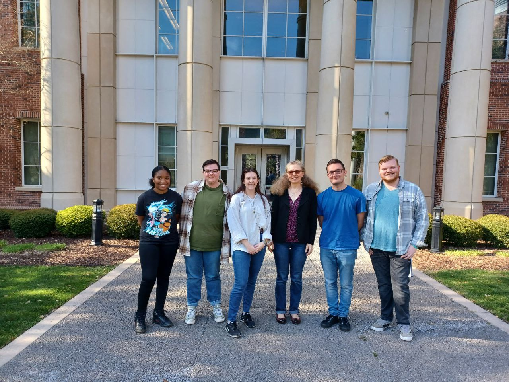

Hello, I am Massimo Aloisi, a Postdoc Fellow at the University of L'Aquila in the CanceЯEvolution Lab. My main scientific interests focus on <strong>disease modelling</strong> and <strong>environmental mutagenesis</strong>.  

I obtained my PhD in Cellular and Molecular Biotechnologies at the University of Teramo, working in the Genetics and Mutagenesis Laboratory. My doctoral research aimed to investigate the role of <strong>genetic background in determining responses to environmental stressors</strong>. In particular, I used <em>in vitro</em> cell cultures and <em>Drosophila melanogaster</em> to investigate the biological and mutagenic effects of micro- and nanoplastics (MPs and NPs). Additionally, I explored the contribution of nanoplastics to cancer progression and their potential role in exacerbating phenotypic severity in genetic models of Polycystic Kidney Disease and TANGO2 Deficiency Disorder using <em>Drosophila</em>.     

My current research focuses on <em>Phoenix Rising</em> in prostate cancer. I use different cancer cell lines and the fruit fly to investigate the molecular mechanisms underlying <strong>resistance to anticancer therapies</strong>. In particular, I am interested in the role of prostaglandin E2 in promoting epithelial–mesenchymal transition (EMT).     

As well as my academic interests, I am committed to <strong>science communication</strong>. Our era is characterised by rapid technological progress; we are immersed in a vast amount of information. I firmly believe that all of this can be misleading and make it difficult to find answers and insights, even for experts. Therefore, science communication is essential to help bringing clarity to this chaotic, information-overloaded system. Engaging with diverse audiences can help both the general public and the scientific community better understand the world around us, exchange knowledge and perspectives, and generate new ideas that may help shape future research directions.   

  <a href="https://www.researchgate.net/lab/CanceAEvolutionLab-Daniela-Grifoni">CanceЯEvolution Lab</a>
   
  

  <a href="https://www.coastal.edu/biology/gamberi">Gamberi's Lab</a>
   
  

