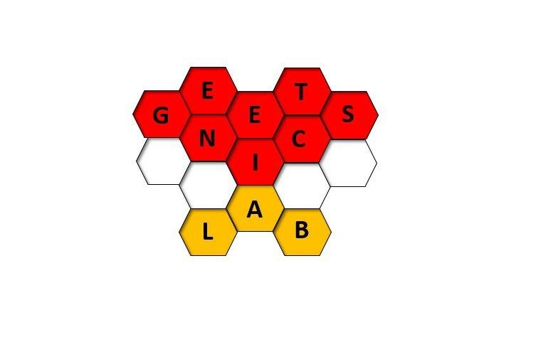

Beyond the bench, what we discover in our laboratories become reality shaping the world and our ideas around it. Today, scientific and technological advances are too far removed to form part of our general knowledge. Even though we use the most sophisticated scientific applications and devices on a daily basis, we do not know how they work. A priority for research and industry should be to engage people in order to bridge this gap. The personal and collective satisfaction gained from mastering (even if only superficially) advanced subjects is invaluable. Here are some attempts of mine to achieve these goals.

Biopills
======

<a href="https://www.biopills.net/">Biopills</a> is a science communication project that combines scientific accuracy with accessible language. Since joining the project in 2016, I have written science articles on the frontiers of research and social challenges. I have also had the opportunity to interview experts and campaigners on topics ranging from the environment to the biomedical sector. Currently, together with six other extraordinary people, we have transformed Biopills into an association, organising seminars, webinars, online courses and ‘field experiences’. At present, I am responsible for general internal coordination and I write the regular newsletter.

During the years I have written article ranging from genetics to cell biology, from biochemistry to molecular biology, from actuality to interviews to experts. If interested, my articles are readable on the <a href="https://www.biopills.net/author/massimo-aloisi/">website</a>. 

European researchers night
======

The end of September each year is brought to life by the European Researchers’ Night. In collaboration with the CanceREvolution laboratory, I organised divulgative stands about our research activities. We took fruit flies out onto the streets, eliciting mixed reactions, ranging from astonishment to fear amongst tbugs haters. In both cases, we managed to inspire wonder at the immense possibilities that <em>Drosophila</em> offers to the biomedical research community. We set up microscopes for observing the flies and recreated a small laboratory dedicated to <em>Drosophila</em>, where children could give free rein to their scientific curiosity by working as little <em>Drosophila</em> scientists.

Additionally, thanks to the amazing coordination of Prof. D. Grifoni, we started the Biology Championship. High school students challenge each others with biology quizzes to useful gadgets for their daily life at school. 

An Instagram page for the UnivAQ genetics laboratories 
======

Since 2022, I handle an instagram page to spread to the academic community and to the general pubblic the scientific activities and achievements of the genetics laboratories of the University of L'Aquila (@geneticslaboratoryaq). Helped by trainees and PhD students, I pubblish scientific images, carousels from conferences and events and lot of memes and fun facts. 

